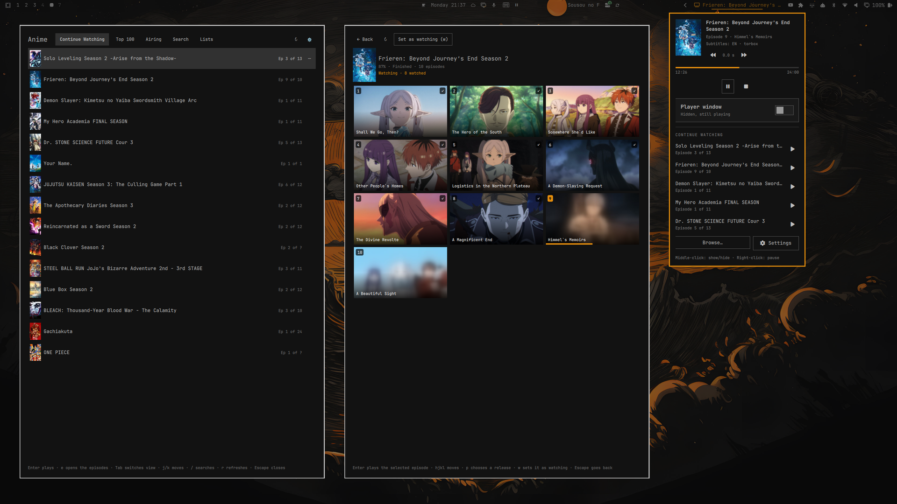

# Anime for Omarchy

**Your anime list lives in the Omarchy bar. Click a show, and it plays.**



- **One click to watch.** The next episode of every show you follow is right there in the bar.
- **Subtitles in your language.** It finds a release that has them, or borrows them from another one.
- **AniList stays up to date.** Finish an episode and it is marked watched.
- **Watch while you wait.** Waiting on a build or an agent? Bring the episode up. Back to work? Pause it and hide
  it, and it waits right where you left off.

## What you need

| | What it does | Cost |
|---|---|---|
| **TorBox** | Streams the episodes to you | about $1.70 a month ([how](#get-torbox-for-about-170-a-month)) |
| **Prowlarr or Jackett** | Finds the episodes | free |
| **AniList** | Keeps your list | free |

You also need **Omarchy 4.0.3 or later**. Everything else the plugin uses comes with it.

### Get TorBox for about $1.70 a month

1. Sign up through a referral link, a friend's or
   [mine](https://torbox.app/subscription?referral=a4ccbf06-f664-4238-99d7-1a457793644b). A referral link gives you
   84 free days on a year.
2. Choose **One-Time**, then **1 Year**, then **Essential** ($36). Essential is all you need, and a year gives you the
   most for your money.
3. Enter the code **`SIGMA30`** and pay with **crypto**. The price drops to $25.20.

That is 449 days for $25.20. The code works only with crypto. (Checked October 29, 2026.)

### Set up AniList first

Put the shows you are watching on **Watching** and the ones you want to see on **Planning**. The plugin shows your
lists exactly as they are, so the tidier they are, the better it works.

### Prowlarr or Jackett

Free programs that search for episodes, running on your own computer. Never used one? Open the plugin's
**Settings** and press **Help me set up Prowlarr**: your AI agent walks you through it.

**The plugin ships no content. Add indexers you are entitled to use.**

## Install

```sh
omarchy plugin add https://github.com/AsemHub/OmaAnime --enable
omarchy restart shell
mkdir -p ~/.local/bin && ln -sf ~/.config/omarchy/plugins/io.github.asemhub.omaanime/bin/omarchy-anime ~/.local/bin/
```

Then click the Anime icon in the bar, open **Settings**, and connect **AniList**, **TorBox** and your **Prowlarr or
Jackett** under Accounts. That's it: pick a show and press play.

## Using it

| | |
|---|---|
| Click the bar icon | Continue Watching, and the player's controls |
| Right-click it | Pause or play |
| Middle-click it | Hide or show the player (hiding does not pause, so you can keep listening) |
| **Browse…** | Top 100, Airing, Search and all your lists, full screen |
| `Tab` in the player | The show's episodes, down the side |

## Learn more

- [Setting up](docs/setup.md): signing in, adding Prowlarr or Jackett, Real-Debrid, uninstalling
- [Using it](docs/using.md): Browse, choosing a release, keys, the player
- [Settings](docs/settings.md): every option and what it changes
- [Troubleshooting](docs/troubleshooting.md): when something does not play
- [Privacy](docs/privacy.md): what is stored on your computer, and what is sent where
- [Indexer add-ons](docs/addons.md): connect another catalogue, or have your AI agent write one
- [From a terminal](docs/terminal.md) and [how it works](docs/architecture.md)

## License

MIT. See [LICENSE](LICENSE).
